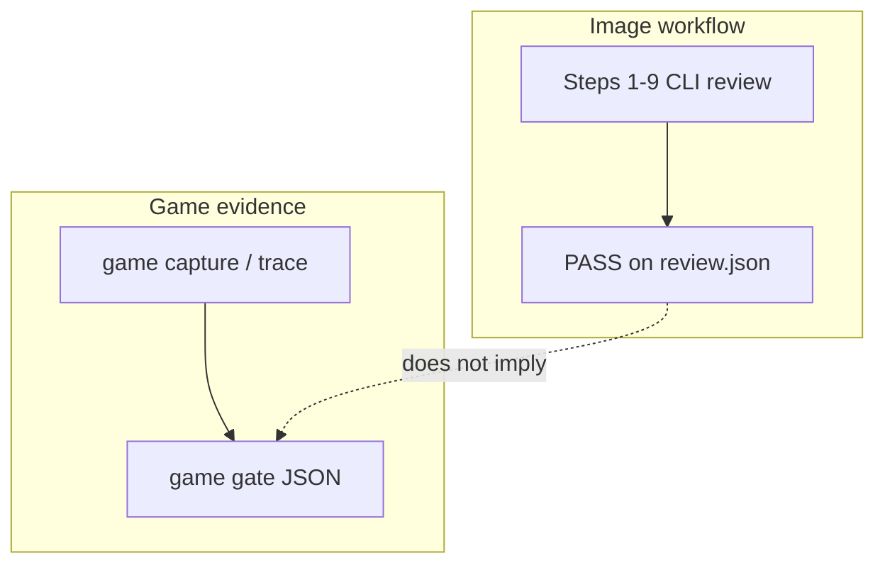

# I-mage-not-AI asset review

Use the existing checkout for this task; do not create a Git worktree.

**First:** infer the user’s primary goal and open [supplementary-skill-flows.md](supplementary-skill-flows.md). Use the **default steps 1–9 below** only when they need feature-mask manifest review (palette/ΔE/mask rules on approved parts). For inventory, required asset paths, sprite-sheet/lighting policies, or game gate, follow the supplementary flow instead of forcing XAL.

## Project setup and policy profiles

- For a new project, establish its conventions once: color interpretation, coordinate system, units, timebase, and any documented asset specs. Keep these in project documentation/configuration with their source. Do not derive mandatory thresholds from visual inspection.
- Store reusable deterministic thresholds in one project rules file (prefer `<project>/.i_mage_not_ai/rules.yaml`). Build selector-based profiles with `asset_type`, `style`, and `feature_role`; reserve `feature_id` rules for documented asset-specific exceptions. Use increasing priorities for narrower rules. Keep measurement formulas/algorithm versions stable across profiles.
- For each asset, identify its actual class/style, select its approved masks/features or trace anchors, and pass the shared rules file to `delegate rules`, `plan`, and `review`. Before review, inspect the resolved rules so a broad default and a narrower override do not collide. Same-target, same-algorithm rules must either resolve by priority or fail as a configuration conflict; never rely on property overwrite order.
- An exception needs a short reason and a user/project source. Do not loosen a threshold just to make a failing asset pass. If a profile is missing a user requirement, report it as needing a threshold or implementation; do not invent a value.
- Treat only registered algorithms as executable. Commands **outside** manifest `review --plan` but in the registry include: `sprite-sheet check` / `compare`, `lighting check`, `project check-assets`, and `scan images`. Supplemental `character anatomy` and `similarity --metric lpips|dinov2` run separately; they require explicit policies/thresholds and report missing evidence or local weights as INCONCLUSIVE. OpenPose inference is not bundled. External AI-image detectors are **not** integrated; do not run or recommend `aidetect` / `aidetector` for this project. Unregistered measurements remain unsupported; state that they were not run.
- If project conventions or profile thresholds already exist, reuse them instead of asking the user to repeat setup. If they do not, prepare a policy draft from known specifications and clearly mark missing decisions before using it for PASS/FAIL review.

## Roles and evidence

Upstream: [CVHub520/X-AnyLabeling](https://github.com/CVHub520/X-AnyLabeling) · **Headless install (step 2):** [docs/x-anylabeling-integration.md § Headless CLI install](../../docs/x-anylabeling-integration.md#headless-cli-install-skill-step-2) — [PR #1485](https://github.com/CVHub520/X-AnyLabeling/pull/1485) branch [`codex/headless-cli-inference`](https://github.com/hyeyoung-Moon/X-AnyLabeling/tree/codex/headless-cli-inference) until merge.

- X-AnyLabeling (XAL) is **required** for the image workflow: step 2 must run headless `segment` (or equivalent XAL inference) before final masks exist. XAL produces first-pass candidate features/masks using a selected annotation model. Codex reviews those candidates against the unchanged source image, corrects the feature decomposition, and marks the final feature set. Do not treat raw model output as approved ground truth, and do not skip XAL by substituting hand-traced masks.
- `i-mage-not-ai` measures only registered algorithms against explicit manifest or project-policy thresholds. It does not infer semantics, evaluate taste, or decide whether an image is AI-generated or “AI slop.”
- Keep XAL candidate output, agent-approved feature metadata/masks, and CLI measurements as separate evidence stages. Every reported CLI result must come from the saved JSON report. Do not turn an agent-inferred feature or visual impression into a mandatory PASS/FAIL threshold.
- Use evidence-oriented findings: identify the final feature and affected region, report the measured value and threshold, state the rule and status, then give a concrete next step when action is needed. State coverage gaps and limitations; unknown or unmeasured is not PASS.

## Image workflow

1. Identify the target PNG, JPEG, WebP, or SVG, the user's explicit design constraints, relevant generation prompt, and any project policy or reference assets. Use the prompt/context to draft a feature inventory before segmentation; do not infer a universal list of features. Do not invent design intent or thresholds. Keep the source image unchanged and record its actual SHA-256.
2. **Generate X-AnyLabeling candidates through its headless inference CLI.** Install XAL from [PR #1485](https://github.com/CVHub520/X-AnyLabeling/pull/1485) branch [`codex/headless-cli-inference`](https://github.com/hyeyoung-Moon/X-AnyLabeling/tree/codex/headless-cli-inference) per [Headless CLI install](../../docs/x-anylabeling-integration.md#headless-cli-install-skill-step-2). Verify `xanylabeling models list --task segmentation` and `xanylabeling segment` work; if not, stop and report the blocker (GUI + `xlabel2mask` fallback: [x-anylabeling-integration.md](../../docs/x-anylabeling-integration.md)). From the XAL checkout and its Python environment, discover models and check the chosen model before inference:

   Put global `--work-dir` before the subcommand when model data should live in a chosen directory:

   ```text
   xanylabeling --work-dir <model-data-dir> models list --task segmentation --json
   xanylabeling --work-dir <model-data-dir> models info <model-id> --json
   xanylabeling --work-dir <model-data-dir> models check <model-id> --device cpu --json
   xanylabeling --work-dir <model-data-dir> segment --input <image> --model <model-id> --prompt <feature> --output <candidate-dir> --json
   ```

   Use `segment --input <image> --model <model-id> --prompt <feature>` for promptable models. Repeat `--prompt` for each feature query, such as `character`, `hair`, or `leaf`. Image-only inference does not mean “find every feature”: GroundingSAM2 requires text prompts, SAM-style models may require point/rectangle marks, and class-based segmenters return only their learned classes. Select modes from reported model capabilities. `models check` does not download missing weights; model loading during `segment` can download configured weights, so make the target data directory and download behavior clear before starting. Do not install dependencies or switch to a remote model silently.

   `models check` is non-downloading. If it reports missing weights, `segment` can download the model files through XAL; state this before starting and use the chosen model-data directory. Proceed when the user requested or authorized that inference/download; otherwise ask before initiating a potentially large download. Save the native annotation, candidate metadata JSON, and one candidate mask per shape under a dedicated candidate directory. Preserve the exact source image and hash. Record XAL version, model/config, actual provider when exposed, prompts/marks, confidence settings, and every CLI result. If headless `models`/`segment` or a usable model/runtime is unavailable, stop this stage and report the blocker; do not substitute hand-traced masks or claim upstream `main` already ships the headless CLI. To resume after a partial run, keep prior candidate exports, mark unreviewed prompts as `unreviewed` in `feature_inventory`, and append new XAL outputs rather than silently replacing candidate history.
3. **Review and finalize candidates in Codex.** Inspect the unchanged source image alongside an overlay/contact sheet of all candidate masks; do not approve candidates by reading labels or scores alone. Compare each mask to the source. Accept, reject, split, merge, rename, and refine candidates; identify important missing features. Use general visual features, not a human-only ontology: objects, object parts, materials, symbols, foreground/background regions, or lighting/shadow regions. Examples include an animal's eye, fur, tail, or horn; a plant's leaf, stem, flower, or fruit; and a scene's sky, ground, building, or vegetation. Avoid splitting unrelated pixels into meaningless regions. Preserve the mapping from each approved feature to its XAL candidate shape/mask where applicable. Record unresolved boundaries and review decisions explicitly. XAL scores indicate model confidence, not semantic approval.
4. **Create final measurement masks only for approved features and supported checks.** Each mask must be a same-size binary PNG: black is outside and any nonzero pixel is inside. Preserve source dimensions and alignment; do not resize or repaint the source. Use unique final feature IDs, meaningful roles, and `parent_id` for useful hierarchies. Feature masks may overlap when concepts overlap; explain the overlap and do not invent an overlap limit. Keep rejected/unreviewed candidates out of the approved feature list.
5. Save final masks and a v0.6 manifest in a dedicated review output directory, using paths relative to the manifest. Include the source image's actual SHA-256 and a non-empty `feature_inventory`. Each requested feature records its description, a disposition (`approved`, `not_found`, `not_applicable`, or `unreviewed`), and every relevant XAL candidate with its own `approved`, `rejected`, or `unreviewed` status. Approved entries map to a feature in `features[]`; not-applicable entries need a rationale. Any required feature not approved or explicitly not-applicable, or any unreviewed candidate, makes review INCONCLUSIVE/INCOMPLETE. Rejected candidate proposals are retained as evidence and do not block when a valid final feature is approved. For approved but visually inferred names/boundaries, set provenance to `agent_inferred`; retain candidate label, model/config, prompt, score, source shape index, and review decision in feature evidence when useful. The manifest `geometry` should point to each final approved mask. The CLI checks file paths, hashes, and mask dimensions, not whether a mask truly represents its semantic label or whether the inventory itself is semantically exhaustive.
6. **Bridge XAL output to the i-mage-not-ai contract.** XAL's `*.candidates.json` is candidate provenance, not a `feature-manifest` and not an approval record. Map only Codex-approved features into `features[]` with stable `id`, `role`, optional `parent_id`, `geometry: {"type": "mask", "path": "..."}`, and provenance. Keep the source asset hash in `asset.sha256`. There is currently no automatic XAL-to-approved-manifest command; create the manifest explicitly and do not mark an XAL candidate approved merely to make the CLI accept it.
7. Select only registered checks supported by the final manifest and evidence. Apply thresholds only when explicitly supplied by the user or project configuration. Default manifest `review` covers palette/luminance, color uniformity, silhouette components, symmetry, occupancy, periodic energy, overlap, and (for schema 0.6) feature inventory completeness. Do not claim these measure aesthetics, cross-part realism, or AI provenance. A deterministic PASS means declared checks passed with complete coverage; it does not prove the image is free of “AI slop.” Optional anatomy, extended mask geometry, and perceptual similarity commands are documented in [optional-extensions.md](optional-extensions.md); run them only when explicitly requested and keep their reports separate unless the manifest/plan includes matching rules.
8. Ask Codex to write a review plan from the approved feature manifest, user requirements, and resolved project rules. For every entry in `execution_plan.checks`, add exactly one `review_intent` item with the same `rule_id`, the same `feature_id` when the check targets a feature (use `null` for asset-level checks), a non-empty `purpose`, and a `threshold_source`. Explain its target feature, cite the source of every threshold, and list relevant limitations and unsupported requests. Do not invent thresholds. Save the plan using `i-mage-not-ai plan --manifest <manifest> --rules-file <rules> --output <review-plan.json>` (omit `--rules-file` when unused). Codex may edit only `review_intent`; the CLI rejects edits to `execution_plan`, `bindings`, or `status`, and rejects missing or mismatched `(rule_id, feature_id)` rationales. If a different algorithm or threshold is needed, update the manifest or rules, regenerate the plan, and review it again.
9. Preflight when helpful: `i-mage-not-ai doctor` (add `--repo-root <checkout>` and `--skill-trial` for the fox example artifacts). Then run, in order:

   ```text
   i-mage-not-ai inspect <image>
   i-mage-not-ai manifest validate <manifest>
   i-mage-not-ai delegate preview --manifest <manifest>
   i-mage-not-ai delegate rules --manifest <manifest>
   i-mage-not-ai review --manifest <manifest> --plan <review-plan.json> --output <review.json>
   i-mage-not-ai coverage --report <review.json>
   i-mage-not-ai explain <review.json>

   Pass the same `--rules-file <rules>` to both `plan` and `review` when project rules are used.
   ```

10–11. **Game capture and gate** (only when the task needs engine/runtime evidence): follow [game-capture-and-gate.md](game-capture-and-gate.md). Do not use image-step PASS as a game gate PASS.
12. Read the saved JSON reports. Summarize each relevant finding with its feature ID, rule, measured value, threshold, status, and region. Distinguish `FAIL`, `INCONCLUSIVE`, `SKIPPED`, and incomplete coverage; unknown or unsupported coverage is not PASS. Keep the original image, generation prompt/context, XAL native candidate output, candidate masks/metadata, agent-approved masks, manifest, review plan, optional visual overlay, and reports together so the result can be reproduced and inspected. The CLI rejects a plan if its manifest/rules hashes or deterministic execution section no longer match current inputs.
13. Use the measurements and source image to write a Codex review that separates measured facts from visual interpretation, calls out uncovered requirements, and gives actionable findings. CLI results are evidence for the review, not a substitute for interpreting the image and user's request.
14. Edit an asset only when the user authorized repair. After a targeted edit, run `i-mage-not-ai verify --before <original> --after <edited> --report <review.json>` with an explicit `regression.allowed_mask` or `regression.allowed_region`, update the hash, and rerun the manifest checks.

## Game trace workflow

See [game-capture-and-gate.md](game-capture-and-gate.md) and `docs/game-engine-export.md`. Trace review never executes project code; visual capture requires explicit opt-in and aggregates three PASS/COMPLETE reports at the gate.

## Workflow branches

Use **one** primary path per task. A static image PASS does not substitute for a game gate PASS.

```text
Image asset (steps 1–9, 12–14)
  XAL → overlay review → manifest v0.6 → plan/review --plan → reports

Game / runtime ([game-capture-and-gate.md](game-capture-and-gate.md))
  trace review + runtime report + render report → game gate (same scenario_id)

Supplementary (see supplementary-skill-flows.md)
  project preview / scan / check-assets / sprite-sheet / lighting

Optional (see optional-extensions.md)
  anatomy / similarity / extra mask metrics — only when requested
```



## CLI exit codes

Agents should treat non-zero exits as structured outcomes, not generic failures.

| Code | Meaning | Typical commands |
|------|---------|------------------|
| 0 | PASS with complete coverage | `review`, `game gate` |
| 1 | FAIL (threshold violated) | `review`, `verify`, `game gate` |
| 2 | INCONCLUSIVE or INCOMPLETE coverage | `review`, `coverage`, delegate preview |
| 3 | Invalid input / manifest / stale plan | `manifest validate`, `review --plan` |
| 4 | Internal or unexpected runtime error | any |

`review --plan` also exits 2 when status is INCONCLUSIVE; exit 1 when status is FAIL.

## Reproducibility

The `i-mage-not-ai` CLI is offline and deterministic for a fixed image, masks, manifest, Python/dependency environment, and rule version. XAL's first-pass model output and the agent's semantic review are separate upstream evidence; preserve the exact candidate files, approved masks, and manifest used for every report. After each XAL inference run, record ONNX weight revision metadata (hashes and model-data directory) alongside `*.candidates.json`; bump the revision when weights change. Preserve overlay review evidence (contact sheets or per-candidate overlays) and structured accept/reject notes before building final masks. Review JSON reports use manifest-relative `asset.path` values, not machine-specific absolute paths. Palette counts use exact RGB values unless fixed Lab bins are explicitly configured. Raster gradient intent is not inferred, and SVG stroke-width checks inspect explicit values only. No automatic hook is assumed; run this Skill explicitly when generation or editing has finished.

Repository example (XAL candidates → Codex review → v0.6 inventory → `plan` → `review_intent` → `review --plan`): `artifacts/skill-segmentation-test/README.md`. Raw XAL exports and contact sheets: `artifacts/xal-fox-candidates-01/`. Extended overlay review audit (12 features): `artifacts/xal-fox-review-01/`. This example and `pytest -m local_skill` are **local-only** (`scripts/run_local_skill_flow.sh`).
