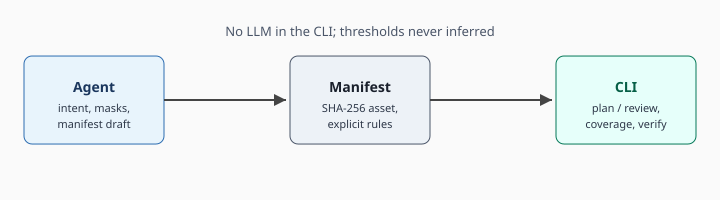
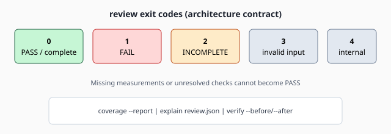

<div align="center">
  
</div>

<div align="center">

# I-mage-not-AI

## Open-source CLI for explicit image design constraints on raster, SVG, and game assets

[](https://www.python.org/downloads/)
[](LICENSE)

Package and command: **`i-mage-not-ai`** · [Quick start](#quick-start) · [X-AnyLabeling integration](docs/x-anylabeling-integration.md) · [Architecture](docs/architecture.md) · [Agent Skill](.agents/skills/i-mage-not-ai/SKILL.md)

</div>

---

## What is I-mage-not-AI?

**I-mage-not-AI** checks raster assets, SVG, and optional game traces against rules you put in a **feature manifest** (and optional project YAML). An external **Agent** interprets intent and drafts manifests; **[X-AnyLabeling](https://github.com/CVHub520/X-AnyLabeling)** (optional, separate install) proposes feature masks that the Agent must approve before review; the **CLI** validates input, plans measurements, evaluates policies, and reports coverage. Default install: no LLM, no network, no automatic editing inside the CLI. See [X-AnyLabeling integration](docs/x-anylabeling-integration.md).

### Verification surfaces

| Surface | Status | Description |
|---------|:------:|-------------|
| **Icon / flat raster** | ✅ | Manifest `review`: palette count, alpha margins, centroid, mask color (CIEDE2000), and related icon rules. |
| **SVG** | ✅ | Safe structural parse — paths (line/Bézier/arc), gradients, strokes; external references and scripts rejected. |
| **Character / masks** | ✅ | Masked palette, luminance, silhouette components, symmetry, overlap; masks checked for file, size, and containment — not semantic label truth. Typical path: [X-AnyLabeling](docs/x-anylabeling-integration.md) candidates → Agent-approved binary PNGs → manifest. |
| **Feature proposals (Agent + XAL)** | ✅ | [X-AnyLabeling](https://github.com/CVHub520/X-AnyLabeling) for AI-assisted segmentation proposals; [Agent Skill](.agents/skills/i-mage-not-ai/SKILL.md) for overlay review and v0.6 manifest. Candidates ≠ PASS. |
| **Game traces** | ✅ | Canonical JSON traces: motion, poses, contacts, particles, layer occlusion; PNG or atlas workflows. |
| **Engine projects** | ✅ | Bounded read-only Godot/Unity discovery; optional `export-trace` only with explicit `--allow-project-code`. |
| **Diagnostics** | ✅ | `measure` and `compare` emit threshold-free metrics — evidence only, not an aesthetic score or PASS/FAIL. |
| **Learned checks** | ✅ | Separate commands (not default `review`): OpenPose anatomy from saved BODY_25 JSON; LPIPS/DINOv2 with local weights (`[perceptual]`). |
| **Benchmark protocol** | ✅ | Synthetic icon faults, detection/repair tracks, local HTML gallery and versioned leaderboard. |

### Non-goals (by design)

| Not this | Why |
|----------|-----|
| **Visual regression** (Percy, Chromatic, [Lost Pixel](https://github.com/lost-pixel/lost-pixel)) | No browser screenshots or golden-image pixel diff; every enforced threshold must be **declared** in manifest or project policy. |
| **LLM or vision inference in `review`** | Labeling and repair live in the **Agent** ([Skill](.agents/skills/i-mage-not-ai/SKILL.md)); the CLI is the deterministic gate. |
| **Automatic image or asset editing** | Verify and report only — the CLI does not modify PNG, SVG, or project files. |
| **Inferred thresholds or “looks fine” PASS** | Missing measurements, ambiguity, or unsupported capabilities stay **INCOMPLETE** — they cannot become PASS. |
| **AI provenance or subjective quality** | Explicit constraint checking only; not “is this AI-generated?” or taste scoring. |
| **Downloading models or running OpenPose** | Optional learned paths use **your** weights and **your** OpenPose JSON; the CLI does not fetch models. |
| **Replace X-AnyLabeling** | We do not ship annotation UI, model zoo, or training tooling; only **approved** masks enter the manifest. |
| **X-AnyLabeling as the constraint engine** | XAL proposes labels/masks; it does not run manifest `review` or declare project thresholds. |

## Table of contents

- [What is I-mage-not-AI?](#what-is-i-mage-not-ai)
- [Quick start](#quick-start)
- [Agent workflow (X-AnyLabeling)](#agent-workflow-x-anylabeling)
- [Visual overview](#visual-overview)
- [Install](#install)
- [How review works](#how-review-works)
- [Command reference](#command-reference)
- [Current measurement packs](#current-measurement-packs)
- [Manifest and agent workflow](#manifest-and-agent-workflow)
- [Labeled benchmark scoring](#labeled-benchmark-scoring)
- [Tests](#tests)
- [Documentation index](#documentation-index)
- [Acknowledgements](#acknowledgements)

## Quick start

From a clone of this repository (about two minutes):

```sh
python3 -m pip install -e .
cd examples
python3 -m i_mage_not_ai manifest validate icon-manifest.json
python3 -m i_mage_not_ai plan --manifest icon-manifest.json
python3 -m i_mage_not_ai review --manifest icon-manifest.json --output review.json
python3 -m i_mage_not_ai coverage --report review.json
```

The installed console script is the same entry point: `i-mage-not-ai --help`.

Optional next steps:

```sh
python3 -m i_mage_not_ai inspect icon/icon.png
python3 -m i_mage_not_ai explain review.json
```

For mask-based assets, use the [Agent workflow](#agent-workflow-x-anylabeling) below instead of hand-authored manifests alone.

## Agent workflow (X-AnyLabeling)

Three evidence stages: **XAL candidates → Agent approval → CLI `review`**. Full contract: [X-AnyLabeling integration](docs/x-anylabeling-integration.md) and the [i-mage-not-ai Skill](.agents/skills/i-mage-not-ai/SKILL.md).

<details>
<summary>End-to-end path (fox forest example, local-only replay)</summary>

1. **Propose masks** — X-AnyLabeling inference (Skill step 2); exports live under `artifacts/xal-fox-candidates-01/`.
2. **Review overlays** — Agent accepts/rejects candidates (contact sheets); see `artifacts/skill-segmentation-test/`.
3. **Manifest v0.6** — Approved binary PNGs + `feature_inventory` → `manifest validate`.
4. **Deterministic gate** — `plan` → `review --plan` → `coverage` / `explain`.

Regenerate and CLI replay:

```sh
python3 -m pip install -e .
python3 artifacts/skill-segmentation-test/segment_features.py
python3 artifacts/skill-segmentation-test/run_cli_workflow.py
# full Skill trial: bash scripts/run_local_skill_flow.sh
```

Walkthrough: [artifacts/skill-segmentation-test/README.md](artifacts/skill-segmentation-test/README.md).

</details>

[Rule authoring](docs/rule-authoring.md) applies once project YAML thresholds exist.

## Visual overview

**Agent vs CLI** — labels and drafts live outside the deterministic gate:



**Review outcomes** — exit codes are part of the architecture contract:



**Example asset** (bundled under `examples/` for the quick start above):


Synthetic benchmark runs can emit a local HTML gallery (`benchmark gallery`); see [Labeled benchmark scoring](#labeled-benchmark-scoring).

## Install

**Requirements:** Python **3.11+**.

```sh
git clone https://github.com/munsunouk/I-mage-not-AI.git
cd I-mage-not-AI
python3 -m pip install -e .
i-mage-not-ai --help
# equivalent: python3 -m i_mage_not_ai --help
```

Optional dependency groups:

| Extra | Install | Purpose |
|-------|---------|---------|
| *(default)* | `pip install -e .` | Deterministic raster/SVG/game checks |
| `dev` | `pip install -e ".[dev]"` | Ruff, mypy, pytest, Hypothesis, jsonschema |
| `perceptual` | `pip install -e ".[perceptual]"` | LPIPS / DINOv2 similarity (local weights only) |

OpenPose anatomy and learned similarity are **separate commands** from manifest `review`; see [character anatomy and similarity checks](docs/learned-character-checks.md). The CLI does not download model weights or run OpenPose.

## How review works

`review` supports `--format json|markdown`. **PASS** requires complete planned-rule coverage and passing required checks. Missing measurements, semantic ambiguity, unsupported capabilities, or unresolved checks **cannot** become PASS.

| Exit code | Meaning |
|-----------|---------|
| 0 | PASS / complete |
| 1 | Explicit FAIL |
| 2 | INCOMPLETE / INCONCLUSIVE |
| 3 | Invalid input or policy |
| 4 | Internal execution error |

`measure` emits threshold-free deterministic raster and approved-mask measurements (diagnostics only; no PASS/FAIL). Lab-bin counts need a configured bin size; CIEDE2000 exceedance ratios need a configured tolerance. SVG and game-trace measurements use their asset workflows.

`compare` reports deterministic cross-feature color, luminance, edge-boundary, texture, and lighting descriptors between a masked foreground and visible pixels outside it — diagnostic evidence, not an inferred aesthetic score.

Project YAML policies apply with `--rules-file` on `delegate rules`, `plan`, and `review` (match conditions, priority, algorithm parameters, capabilities, explicit assertions). Equal-priority contradictory rules are rejected.

## Command reference

Full CLI surface (also `i-mage-not-ai --help` and subcommand `--help`):

```sh
i-mage-not-ai inspect icon.svg
i-mage-not-ai manifest validate manifest.json
i-mage-not-ai measure --manifest manifest.json --output measurements.json
i-mage-not-ai compare --manifest manifest.json --feature fox_character --output context-fit.json
i-mage-not-ai character anatomy --image character.png --openpose-json openpose.json --policy anatomy-policy.json --output anatomy-report.json
i-mage-not-ai similarity --metric lpips --reference reference.png --candidate candidate.png --max-distance 0.18
i-mage-not-ai similarity --metric dinov2 --reference reference.png --candidate candidate.png --model-dir models/dinov2-base --min-similarity 0.82
i-mage-not-ai delegate preview --manifest manifest.json
i-mage-not-ai delegate rules --manifest manifest.json
i-mage-not-ai delegate rules --manifest manifest.json --rules-file project-rules.yaml
i-mage-not-ai plan --manifest manifest.json
i-mage-not-ai review --manifest manifest.json --output review.json
i-mage-not-ai coverage --report review.json
i-mage-not-ai explain review.json
i-mage-not-ai verify --before original.png --after edited.png --report review.json
i-mage-not-ai benchmark score --ground-truth benchmark/ground-truth.json --predictions predictions.json --output benchmark-score.json
i-mage-not-ai benchmark generate-synthetic --output-dir benchmark/synthetic --count 20
i-mage-not-ai benchmark init-submission --dataset benchmark/synthetic/dataset.json --output benchmark/submission.json
i-mage-not-ai benchmark evaluate --dataset benchmark/synthetic/dataset.json --submission benchmark/submission.json --output benchmark/result.json
i-mage-not-ai benchmark leaderboard-add --result benchmark/result.json --leaderboard benchmark/leaderboard.json --run-id run-001
i-mage-not-ai benchmark gallery --dataset benchmark/synthetic/dataset.json --submission benchmark/submission.json --result benchmark/result.json --output benchmark/gallery/index.html
```

Game, project, sprite-sheet, lighting, and render commands are documented in [game policy reference](docs/game-policy-reference.md), [sprite and lighting policy](docs/sprite-lighting-policy.md), and [project discovery](docs/project-discovery.md).

## Current measurement packs

Icon rules include exact or fixed Lab-bin palette count, alpha bounds/margins, centroid, solid-color masks with CIEDE2000, SVG gradients/strokes, and SVG Path geometry. Character rules include masked palette and luminance levels, silhouette components, symmetry, and pairwise mask overlap. The supplemental `character_anatomy` pack measures OpenPose BODY_25 segment ratios and joint angles against an explicit policy; `character_similarity` provides LPIPS patch distance and DINOv2 CLS cosine similarity against a reference. These commands run separately from manifest `review`; model output is not treated as ground truth and thresholds are never inferred. Background rules include occupancy, tile-edge difference, FFT periodic-energy ratio, and a fitted RGB-plane diagnostic. All enforced thresholds must come from explicit manifest or project policy.

SVG Path inspection parses line, Bézier, and elliptical arc segments and reports bounds, length, and types. Path-local transforms are not applied; constrained transformed Paths are inconclusive. External SVG references and scripts are rejected.

Raster `max_path` metrics are not supported. Raster gradient-fit R² is diagnostic only and stays INCONCLUSIVE. Palette counting defaults to exact RGB tuples; optional fixed Lab bins are deterministic and do not use clustering. Canonical JSON game traces support position/velocity/acceleration/jerk, quaternion rotation, pose and loop boundaries, bone length, contact foot sliding, anchor distance, event timing, particle lifetime/bounds, and alpha-weighted occlusion across PNG layers or atlas regions. Use `i-mage-not-ai game analyze` or the standard manifest `plan`/`review` flow. Local positions compose through synchronized parents with per-sample basis matrices. `i-mage-not-ai project preview` performs bounded, read-only Godot/Unity project discovery and reports image references and skipped paths. `i-mage-not-ai project manifest` creates a hash-pinned draft without inferred features or thresholds. Separate `project export-trace` commands explicitly invoke an engine exporter and require `--allow-project-code`; selected scenes/editor integrations can run project code. The CLI still does not load plugins or edit assets automatically.

## Manifest and agent workflow

See [manifest schema](schemas/feature-manifest.schema.json), [game trace schema](schemas/game-trace.schema.json), [X-AnyLabeling integration](docs/x-anylabeling-integration.md), [engine export contract](docs/game-engine-export.md), [plugin API](docs/plugin-api.md), [architecture](docs/architecture.md), [rule authoring](docs/rule-authoring.md), [game roadmap](docs/game-asset-roadmap.md), and the [i-mage-not-ai Codex/Cursor Skill](.agents/skills/i-mage-not-ai/SKILL.md). Version 0.5 manifests require the source asset SHA-256; legacy 0.1 manifests remain accepted. The installable package version tracks architecture v0.5 (`0.5.0`); manifest schema 0.6 is supported and review reports echo the manifest schema version. Masks are validated for file, path containment, and dimensions, not semantic correctness. The agent must record provenance and never invent measured values.

Phase 0–4 scope and verification evidence are listed in [phase status](docs/phase-status.md). Reproduce the raster performance measurement with `python benchmarks/benchmark_review.py 1024 3`.

## Labeled benchmark scoring

`i-mage-not-ai benchmark score` compares rule-level findings with a versioned ground-truth JSON file. Ground truth has `schema_version: "1"`, `dataset_id`, `dataset_version`, and a `findings` array of `{case_id, rule_id}` violations. The predictions file contains a `findings` array with `{case_id, rule_id, status}` records; only `FAIL` counts as a predicted violation. Duplicate finding identities are invalid. The report includes TP/FP/FN, precision, recall, and F1. Undefined metrics are `null` when their denominator is zero. Scores are scoped to one dataset version and do not establish image quality or benchmark validity by themselves.

`generate-synthetic` writes deterministic 32×32 flat icon pairs, alternating between an injected extra-color fault and an insufficient-transparent-margin fault. Each case has a ground-truth rule label and explicit editable pixel region(s). `init-submission` creates a skeleton for the three tracks (`original`, `agent_only`, `agent_plus_tool`), including every case ID. Fill each agent track's `assets` map with PNG paths relative to the submission file, then record `agent`, `model`, `prompt_version`, and `environment` metadata. The protocol also requires a shared prompt SHA-256, attempt limit, environment image, and seed. Evaluation rejects mismatched declared model, prompt, or environment metadata. The original track uses the generated faulty assets. `evaluate` rechecks source SHA-256 hashes and independently measures each output's visible palette count, normalized alpha margins, and RGBA changes outside editable regions. It calculates detection metrics, repair success, remaining violations, and preservation from those measurements. Only `VERIFIED_SYNTHETIC` reports can be added to a local leaderboard, which is separated by dataset version and ranked by fewer remaining violations, repair success, then preservation; detection F1 is reported but does not determine repair ranking. This leaderboard covers synthetic icon palette and margin faults only; it does not verify real-world benchmark claims or prove that two agent runs were operationally identical.

`gallery` re-runs the image validation before writing a static local HTML comparison. It shows original, agent-only, and tool-assisted images alongside track-level precision, recall, F1, repair success, and preservation. Keep the HTML file with access to the relative image files referenced by the submission and dataset; this is a local report, not a published website.

## Tests

```sh
python3 -m pip install -e ".[dev]"
python3 -m pytest -q
python3 scripts/sync_engine_resources.py --check
ruff check i_mage_not_ai tests benchmarks
mypy i_mage_not_ai tests benchmarks
```

Runtime tests target Python 3.11. Mypy is configured for Python 3.12 in `pyproject.toml` to parse the installed NumPy type stubs. The Skill/XAL fox trial is optional: `python3 -m pytest -q -m local_skill` or `bash scripts/run_local_skill_flow.sh`.

## Documentation index

| Topic | Link |
|-------|------|
| X-AnyLabeling integration | [docs/x-anylabeling-integration.md](docs/x-anylabeling-integration.md) |
| Agent Skill (XAL → review) | [.agents/skills/i-mage-not-ai/SKILL.md](.agents/skills/i-mage-not-ai/SKILL.md) |
| Skill example (fox forest) | [artifacts/skill-segmentation-test/README.md](artifacts/skill-segmentation-test/README.md) |
| Architecture | [docs/architecture.md](docs/architecture.md) |
| Algorithm catalog (70 IDs) | [docs/algorithm-catalog.md](docs/algorithm-catalog.md) |
| Literature / gap matrix | [docs/algorithm-literature-map.md](docs/algorithm-literature-map.md) |
| Game three-tower gate | [docs/game-three-tower-architecture.md](docs/game-three-tower-architecture.md) |

## Acknowledgements

- [X-AnyLabeling](https://github.com/CVHub520/X-AnyLabeling) (GPL v3) — recommended separate install for AI-assisted segmentation **proposals** in the Agent workflow; not bundled with this MIT project. Integration guide: [docs/x-anylabeling-integration.md](docs/x-anylabeling-integration.md).

Contributions: open a pull request with tests for behavior changes; keep deterministic checks free of network and LLM dependencies in the default install path.
